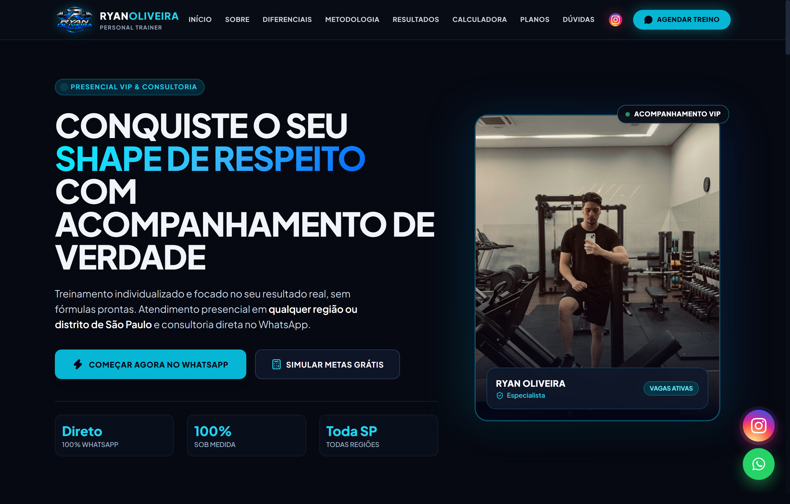
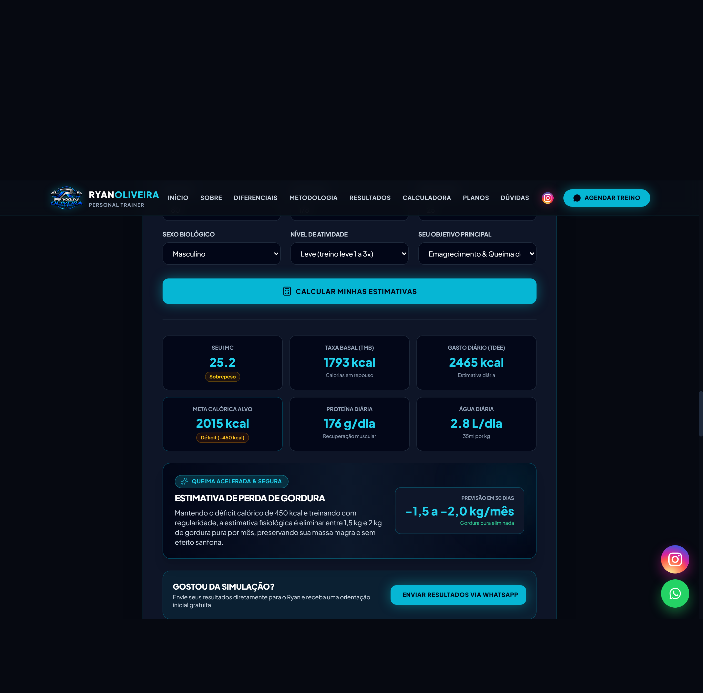
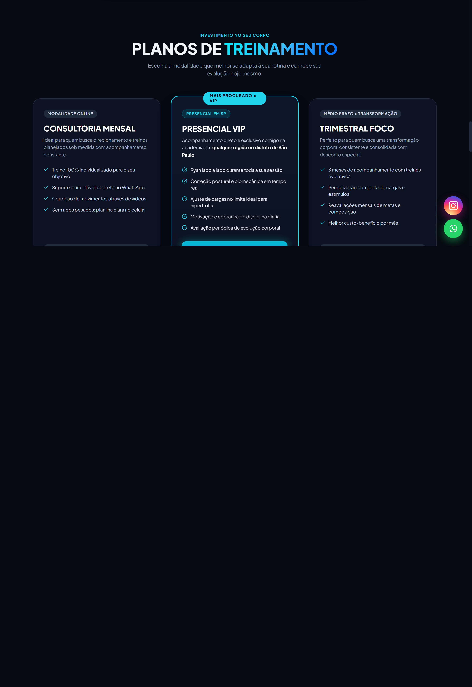
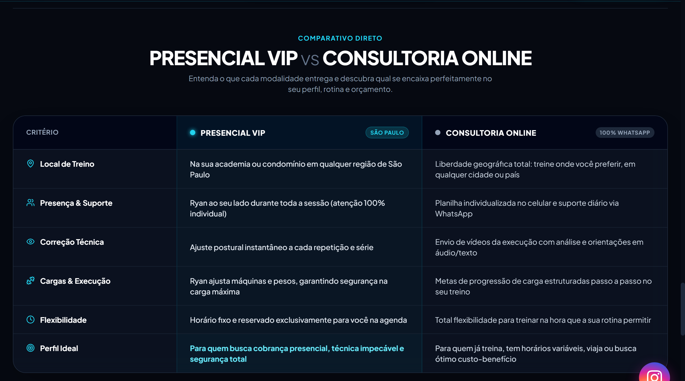

<div align="center">

# 🏋️‍♂️ Ryan Oliveira | Personal Trainer & Consultoria Fitness

**Landing Page de Alta Conversão, Calculadora Fitness Inteligente e Presença Digital**

[](https://ryanoliveira-personal.web.app)
[](https://renan-de-paula.github.io/ryan-oliveira-personal/)
[](https://tailwindcss.com/)
[](https://developer.mozilla.org/pt-BR/docs/Web/JavaScript)
[](https://ryanoliveira-personal.web.app/manifest.json)
[](https://ryanoliveira-personal.web.app)

<br />

🌐 **Site Oficial (Firebase Hosting):** [https://ryanoliveira-personal.web.app](https://ryanoliveira-personal.web.app)  
📄 **Deploy GitHub Pages (Mirror):** [https://renan-de-paula.github.io/ryan-oliveira-personal/](https://renan-de-paula.github.io/ryan-oliveira-personal/)  
📸 **Instagram Oficial:** [@ryan._trainer](https://www.instagram.com/ryan._trainer/)  
💬 **WhatsApp de Contato:** [+55 (11) 99743-3402](https://wa.me/5511997433402)

</div>

---

## 📌 Sobre o Projeto

Plataforma digital moderna desenvolvida sob medida para o personal trainer **Ryan Oliveira**, com foco exclusivo em captação e conversão de novos alunos para treinos **Presenciais VIP em qualquer região de São Paulo/SP** e **Consultoria Online Personalizada**.

O projeto adota uma arquitetura *Mobile-First*, tema escuro (*dark modern theme* `#060911`) com estética neon ciano, efeitos de *glassmorphism*, ferramentas interativas e integração completa com a API do WhatsApp para captação instantânea de leads qualificados.

---

## 📸 Demonstração Visual

### 1. Seção Principal (Hero & Apresentação)
Design imersivo com proposta de valor direta, credenciais do profissional, chamada para ação imediata e link com o perfil do Instagram.



---

### 2. Calculadora Fitness & Previsão de Resultados em 30 Dias
Ferramenta interativa que calcula:
- **IMC** com classificação visual colorida
- **Taxa Metabólica Basal (TMB)** pela fórmula de *Mifflin-St Jeor*
- **Gasto Calórico Diário (TDEE)** por nível de atividade física
- **Meta Calórica Alvo** (déficit para emagrecimento ou superávit para hipertrofia)
- **Meta de Proteína Diária** e **Ingestão Hídrica Recomendada**
- **Box de Estimativa Científica em 30 Dias** (previsão fisiológica realista sem promessas milagrosas)
- **Botão Direto:** Envia toda a simulação detalhada para o WhatsApp do Ryan com um único clique.



---

### 3. Planos de Treinamento
Exibição clara das modalidades com destaque para o **Presencial VIP**, além dos planos mensais e trimestrais de consultoria.



---

### 4. Comparativo Direto: Presencial VIP vs. Consultoria Online
Tabela comparativa lado a lado que detalha 6 critérios decisórios (*Local, Presença, Correção Técnica, Cargas & Segurança, Flexibilidade e Perfil Ideal*).



---

### 5. Quebra de Objeção: Conversa Diagnóstica de 15 Minutos
Card de alta conversão oferecendo uma conversa estratégica sem compromisso via WhatsApp para alunos indecisos.


---

### 6. Experiência Mobile & Ações Flutuantes
Layout homologado sem transbordamento horizontal em telas de **320px a 440px** (iPhone SE, Galaxy A55, iPhone 16 Pro Max), contando com **botões flutuantes duplos** com animação de pulso luminoso (*pulse ring*) para Instagram e WhatsApp.

<div align="center">
  
</div>

---

## ⚡ Principais Tecnologias & Engenharia

| Tecnologia | Finalidade |
| :--- | :--- |
| **HTML5 Semântico** | Estruturação acessível, tags semânticas (`main`, `section`, `article`, `header`, `footer`) e dados estruturados. |
| **Tailwind CSS & CSS3 Puro** | Estilização utilitária, suporte a *glassmorphism*, sombras neon ciano e regras avançadas de responsividade. |
| **JavaScript Vanilla (ES6+)** | Lógica da calculadora nutricional, acordeão de perguntas frequentes, scroll suave e integração dinâmica de mensagens via URI encoding. |
| **Lucide Icons** | Biblioteca leve de ícones vetoriais modernos. |
| **PWA (Progressive Web App)** | Arquivo `manifest.json` com ícones de 192px e 512px, permitindo instalação na tela de início no Android e iPhone. |
| **Schema.org (JSON-LD)** | Marcação avançada com `ProfessionalService`, `Person` e `FAQPage` para indexação avançada e *Rich Snippets* no Google. |
| **Firebase Hosting** | Hospedagem em CDN global de alta velocidade com SSL automático e cache otimizado. |

---

## 📁 Estrutura de Diretórios

```
site_ryan_oliveira/
├── assets/
│   └── screenshots/              # Capturas em alta resolução documentando cada seção
│       ├── 01-hero-section.png
│       ├── 02-calculadora-fitness.png
│       ├── 03-planos-treinamento.png
│       ├── 04-comparativo-modalidades.png
│       ├── 05-conversa-diagnostica.png
│       └── 06-mobile-responsivo.png
├── src/
│   ├── css/
│   │   └── styles.css            # Animações de pulso, glassmorphism e controle do accordion
│   ├── javascript/
│   │   └── script.js             # Lógica da Calculadora, Menu Mobile, FAQ e montagem da mensagem do WhatsApp
│   └── img/
│       ├── perfil.jpg            # Foto de alta resolução do profissional
│       ├── logo.png              # Logotipo oficial
│       ├── instagram-logo.png    # Logo vetorial do Instagram
│       ├── favicon.png           # Favicon do site
│       ├── favicon-32.png        # Favicon 32x32
│       ├── favicon-192.png       # Ícone PWA 192x192
│       └── favicon-512.png       # Ícone PWA de alta definição 512x512
├── index.html                    # Página principal completa, semântica e responsiva
├── favicon.ico                   # Favicon clássico para navegadores
├── manifest.json                 # Manifesto PWA para instalação como app mobile
├── robots.txt                    # Instruções de rastreamento para motores de busca
├── sitemap.xml                   # Mapa de URLs para Google Search Console
├── firebase.json                 # Configuração de rotas e cache do Firebase Hosting
├── .firebaserc                   # Associação com o projeto Firebase ryanoliveira-personal
├── .gitignore                    # Regras de exclusão do Git
└── README.md                     # Documentação completa do repositório
```

---

## 🛠️ Como Executar o Projeto Localmente

### Pré-requisitos
Qualquer navegador web moderno (Google Chrome, Microsoft Edge, Safari, Firefox). Nenhuma instalação pesada ou banco de dados é necessária.

### Opção 1: Execução Direta
Basta dar dois cliques no arquivo `index.html` ou arrastá-lo para uma aba do navegador.

### Opção 2: Com Servidor Local (Recomendado para testar PWA)
Se tiver o **Node.js** instalado:
```bash
# Executar servidor estático local
npx serve .
```
Ou usando a extensão **Live Server** no VS Code.

---

## ☁️ Deploy no Firebase Hosting

O site está configurado para o Firebase Hosting no projeto **`ryanoliveira-personal`**.

Para publicar novas versões no ar:
```bash
# 1. Login no Firebase (caso ainda não esteja logado)
npx firebase-tools login

# 2. Publicar apenas o Hosting
npx firebase-tools deploy --only hosting
```

A URL de produção é atualizada automaticamente em:  
👉 **[https://ryanoliveira-personal.web.app](https://ryanoliveira-personal.web.app)**

---

## 📄 Licença

Este projeto foi desenvolvido como propriedade profissional exclusiva para **Ryan Oliveira Personal Trainer**. Todos os direitos reservados.
